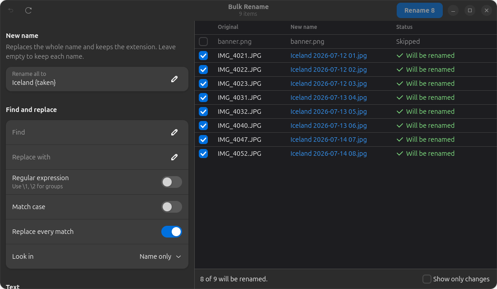
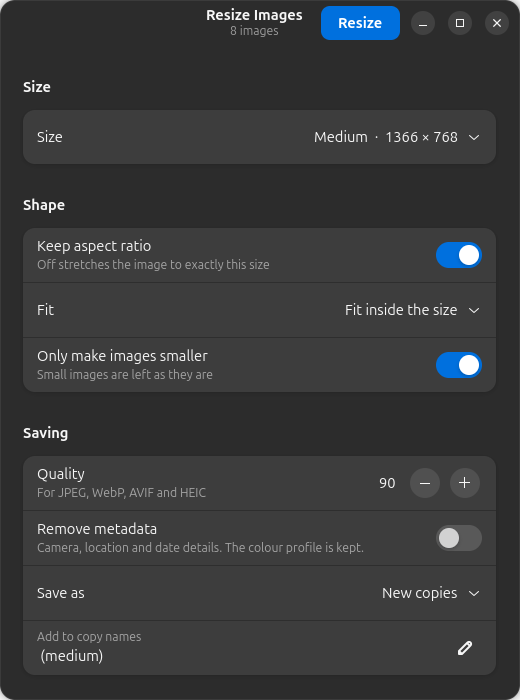
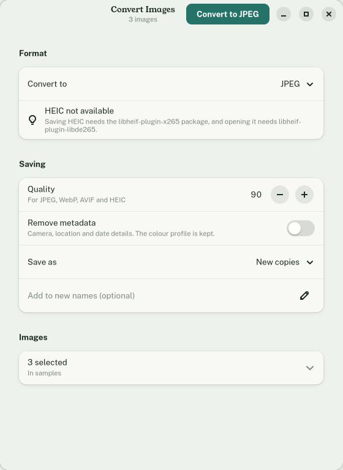

# Spruce

*Part of the Sedge family of webhookstudios apps.*

Select some files in the Files app, right-click them, and choose **Bulk Rename…**, **Resize Images…** or **Convert Images…**. Each opens a small window where you choose what to do, check it, and run it on the whole batch at once.



## Where the options appear

| Right-click this | You get |
|---|---|
| Any files or folders | **Bulk Rename…** |
| Images (PNG, JPEG, WebP, AVIF, HEIC, GIF, BMP, TIFF) | **Resize Images…** and **Convert Images…** too |

If the selection mixes images with other files, the image options show how many images they will work on, such as **Resize Images… (3)**, and leave the rest alone.

Files already has its own **Rename…** item for several files. Spruce's is called **Bulk Rename…** so the two are easy to tell apart.

## Bulk Rename

Everything you change shows up straight away in the preview, with the old name, the new name and whether it can be renamed. The steps run in the order of the table below: a new name first, then find and replace, case, added text, numbering and the extension.

| Option | What it does |
|---|---|
| New name | Replaces each whole name with your text and keeps the extension, so `IMG_4021.JPG` can become `Holiday 01.JPG`. Typing a name for several items switches on numbering once, so the names stay different |
| Find and replace | Plain text or a regular expression (use `\1`, `\2` for groups). Choose whether to match case, replace every match or only the first, and whether to look in the name, the extension or both |
| Add before, Add after | Text added to the start or end of the name |
| Letter case | lowercase, UPPERCASE, Title Case or Sentence case |
| Numbering | Adds a number before or after the name, with a start value, a step, how many digits (`01`, `001`) and a separator |
| Order | Numbers follow the order in the preview: by name (so `img2` comes before `img10`), date modified, date taken, or the order you selected the files in |
| Extension | Keep it, make it lowercase or UPPERCASE, change it, or remove it |

You can type these tokens into any text box. Click one in the **Tokens** list to copy it.

| Token | Becomes |
|---|---|
| `{n}` | The number, using the numbering settings |
| `{name}`, `{ext}` | The original name and extension |
| `{date}`, `{time}` | When the file was last changed. Set the date format in **Date format** (`%Y-%m-%d` by default) |
| `{taken}` | When the photo was taken, from its EXIF data, or the date changed if it has none |
| `{camera}` | The camera model, from the photo |
| `{width}`, `{height}` | The image size in pixels |
| `{parent}` | The name of the folder the file is in |

### Conflicts

Items that cannot be renamed are shown in red with the reason, and are skipped:

- two items would get the same name (also when only the letter case differs, because USB drives ignore case)
- a file with the new name already exists
- the name would be empty, contain `/`, be too long, or turn into a hidden file

Untick an item to leave it out. Swapping two names (`a` → `b`, `b` → `a`) and changing only the letter case both work.

### Undo

After renaming, click **Undo** in the message at the bottom, or the undo button in the top left, to put every name back. Spruce remembers the last batch even after you close the window: open **Spruce** from the apps menu and choose **Undo last bulk rename**, or run `spruce undo`.

## Resize Images



| Option | Default | What it does |
|---|---|---|
| Size | Small | Small (854 × 480), Medium (1366 × 768), Large (1920 × 1080), Phone (320 × 568), or Custom in pixels or percent. A custom height of 0 means any height |
| Keep aspect ratio | On | Off stretches each image to exactly that size |
| Fit | Fit inside | **Fit inside** keeps the whole picture within the size. **Fill and crop** covers the size and trims the edges |
| Only make images smaller | On | Images already smaller than the size are skipped |

Portrait photos are turned the right way up first, so a phone picture fits the size the way you see it.

## Convert Images



Converts to **PNG**, **JPEG**, **WebP**, **AVIF** or **HEIC**. Only the formats your system can save are listed. Ubuntu can save AVIF out of the box. For HEIC, install `libheif-plugin-x265` to save and `libheif-plugin-libde265` to open. Images already in the chosen format are skipped. Transparent areas become white in JPEG.

## Saving (both image tools)

| Option | Default | What it does |
|---|---|---|
| Quality | 90 | For JPEG, WebP, AVIF and HEIC. Lower makes smaller files |
| Remove metadata | Off | Leaves out camera, location and date details. The colour profile is kept, so colours look the same |
| Save as | New copies | **New copies** are saved next to the originals with the text you choose added to the name, such as `photo (medium).jpg`. Spruce never overwrites an existing file; it adds `(2)`, `(3)` and so on instead |

**Replace originals** asks first. Resize overwrites each image. Convert saves the new file and moves the original to the Trash, so you can still get it back. On drives without a Trash (some USB drives and network shares), the original is kept and Spruce tells you.

A progress bar shows how far the batch has got, and **Cancel** stops after the current image. One image that cannot be read does not stop the others. Each file is written under a temporary name first and only moved into place once it is complete.

## Requirements

- Ubuntu 26.04 (GNOME 50) or similar, with GTK 4 and libadwaita 1.5 or newer
- Python 3 with PyGObject and Pillow
- `python3-nautilus` for the Files right-click (the deb package pulls it in)

Spruce has only been tested on Ubuntu 26.04 with GNOME Shell 50.1 and Files 50.

## Install

### With the deb package (recommended)

Download `spruce_1.2.0_all.deb` from the [latest release](https://github.com/webhookstudios/spruce/releases/latest), then install it:

```bash
sudo apt install ./spruce_1.2.0_all.deb
```

Close Files so it picks up the new options:

```bash
nautilus -q
```

To remove it:

```bash
sudo apt remove spruce
```

You can also install and update it from [Grove](https://github.com/webhookstudios/grove).

### From source

```bash
git clone https://github.com/webhookstudios/spruce.git
```

```bash
./spruce/install.sh
```

This installs for your user only. Then run `nautilus -q` once. To remove it, run `./spruce/install.sh --uninstall`.

## Command line

```bash
spruce rename FILE...
```

`spruce resize FILE...` and `spruce convert FILE...` open the other windows, and `spruce undo` puts back the last bulk rename.

## Limitations

- Animated GIF and WebP images stay animated when resized to the same format. Converting one to JPEG, AVIF or HEIC keeps only the first frame.
- SVG and RAW camera files are not supported by the image tools. Bulk Rename works on any file.
- Undo covers only the most recent bulk rename. Resizing or converting cannot be undone, which is why both make copies unless you choose otherwise.
- The Files options appear for files on this computer, including USB drives. They do not appear for items on network locations that Files opens through its own connection (`sftp://`, `smb://`).

## How it works

The Files part is a small Python extension in `nautilus/`, loaded by nautilus-python like Wayside's. It adds the menu items and starts the `spruce` command with the selected paths. The app is Python with GTK 4 and libadwaita. Pillow reads and writes most formats. AVIF and HEIC go straight to libheif, which GNOME already installs, because Ubuntu's Pillow cannot handle them.

| File | Purpose |
|---|---|
| `nautilus/spruce_nautilus.py` | The Files right-click options |
| `spruce/rename.py` | Working out new names, conflicts, renaming and undo |
| `spruce/images.py` | Loading, resizing and saving images |
| `spruce/heif.py` | AVIF and HEIC through libheif |
| `spruce/rename_window.py`, `spruce/image_window.py` | The windows |
| `spruce/app.py` | Starting up and the command line |

## Development

Run it from the source folder:

```bash
./bin/spruce rename ~/Pictures/*.jpg
```

```bash
python3 -m unittest discover -s tests
```

Build the deb package into `dist/` with `./build-deb.sh` (needs only `dpkg-deb`). `docs/make-screenshots.py` redraws the screenshots from a folder of sample images.

## License

GPL-2.0-or-later. See [LICENSE](LICENSE).
